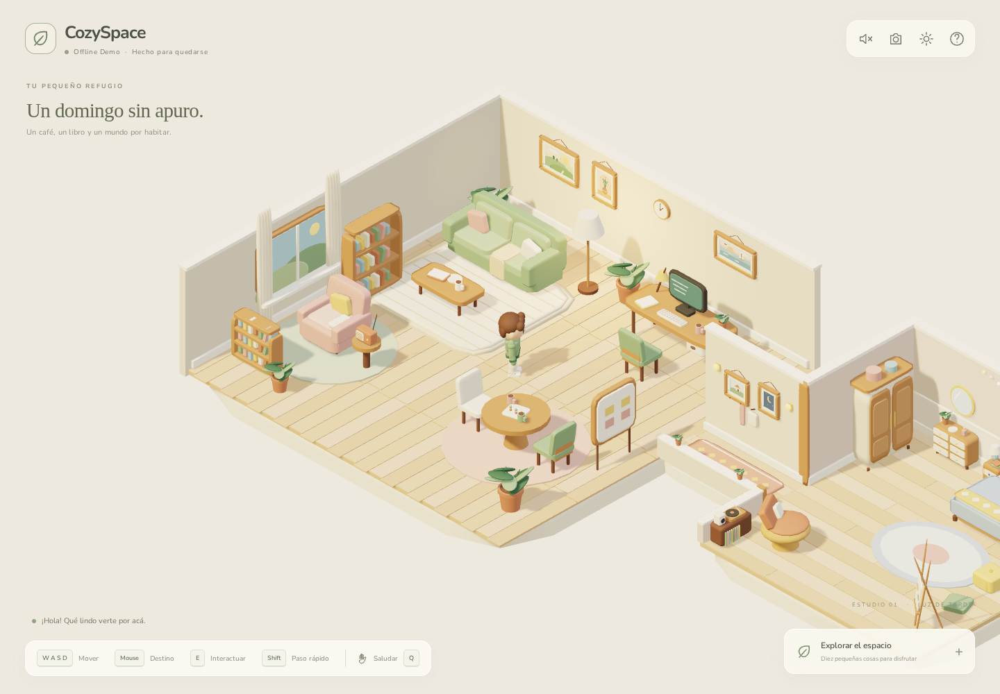

# CozySpace 3D

Un departamento isométrico offline para pasear, leer, compartir ideas y escuchar una radio de domingo. Avatar original «Nilo», un estudio con cuatro rincones, un pasillo que lleva a un dormitorio y diez interacciones. React + TypeScript estricto + Vite + PlayCanvas Engine + `@playcanvas/react`. Sin Three.js.



## Ejecutar

Requisitos: Node.js 22.12+ (o versión moderna compatible con Vite 8), pnpm y un navegador con WebGL2. Instalación inicial con Internet:

```bash
pnpm install --frozen-lockfile
pnpm dev
```

Abrir <http://localhost:5173>. El servidor escucha en todas las interfaces para poder probar en otros dispositivos de tu red. No se implementa comunicación entre jugadores.

```bash
pnpm build
pnpm preview --port 4173
```

Abrir <http://localhost:4173> para el build. Una vez instaladas las dependencias, ambos modos funcionan sin Internet. La demo necesita un servidor local; no se abre mediante `file://` y no instala un service worker.

## Controles

| Control                             | Acción                                           |
| ----------------------------------- | ------------------------------------------------ |
| WASD / flechas                      | Caminar según la orientación de cámara           |
| Shift                               | Caminar más rápido                               |
| Clic sobre un sector libre del piso | Buscar un camino y caminar hasta el destino      |
| E                                   | Interactuar con el objeto cercano / levantarse   |
| Q / botón Saludar                   | Saludo                                           |
| Rueda del mouse                     | Zoom moderado                                    |
| Botón de cámara                     | Vista general / seguimiento suave                |
| Explorar                            | Caminar hasta un objeto y activar su interacción |
| Tab, Enter, Escape                  | Navegar controles HTML / cerrar paneles          |

No es necesario apuntar a un mueble: acercate y usá E. Un indicador muestra el objeto disponible. Al escribir notas, el teclado del juego queda suspendido.

## Funcionalidades

- Diorama cutaway de 12 × 12: living, escritorio, lectura y mesa social.
- Muebles procedurales con superficies redondeadas, patas, almohadones, manta, teclas, libros, tazas, cuadros, ventana y cortinas. Materiales compartidos mate y paleta pastel.
- Cámara ortográfica a 45° de azimut y aproximadamente 34° de elevación, interpolación y zoom.
- Nilo: rostro, cabello, sweater, bolsillo, pantalón y zapatillas; pivotes articulados para respirar, caminar, girar, sentarse, levantarse, saludar e interactuar; parpadeo.
- Movimiento cinemático con deslizamiento por obstáculos, zonas de piso caminable (estudio, pasillo y dormitorio), A* de ocho vecinos y simplificación de trayectorias mediante visibilidad.
- Sofá y silla: desplazamiento al punto de acceso, transición de pose y permanencia sentado hasta E.
- Lámpara: luz local y emisión con transición; estado persistente.
- Monitor: pantalla encendida y videollamada ilustrada **simulada**, sin cámara, micrófono ni red.
- Biblioteca: selección entre tres libros originales con portadas procedurales HTML.
- Pizarra: notas guardadas explícitamente en localStorage y recuperadas al volver.
- Planta: gesto, gotas animadas y feedback durante el riego.
- Radio: melodía WAV original empaquetada, reproducción explícita, volumen, pausa.
- Oscilación suave de plantas/cortinas, reloj, polvo iluminado y sombras filtradas.
- HUD accesible, paneles con foco contenido, retorno de foco, ayuda y ajustes. Preferencias de cámara, volumen, gráficos, FPS y reducción de animaciones persistentes.
- Batching estático, materiales/meshes compartidos, límite de pixel ratio, calidad liviana sin sombras y limpieza de listeners/recursos.

## Pruebas

```bash
pnpm test
pnpm exec playwright install chromium # descarga inicial del navegador de pruebas
pnpm test:e2e
```

Playwright levanta automáticamente el **build de producción** en el puerto 4173; corré `pnpm build` antes. Chromium usa SwiftShader para poder validar WebGL2 en entornos sin GPU. Los tests recorren movimiento, saludo, clic en piso, los ocho objetos, persistencia tras recarga, preferencias, interfaz angosta y errores de consola. El recorrido principal bloquea cualquier request que no sea localhost. Señales `data-*` del avatar permiten verificar estados y posición sin inferirlos de píxeles.

Las capturas finales quedan en `docs/cozyspace-overview.png`, `docs/cozyspace-call.png` y `docs/cozyspace-mobile.png` y `docs/cozyspace-seated.png`. Los tiempos de espera contemplan renderizado por software; no son una medición de rendimiento de una GPU real.

## Documentación

- [Arquitectura](docs/ARCHITECTURE.md)
- [Validación y limitaciones](docs/VALIDATION.md)
- [Créditos y licencias](ASSET_CREDITS.md)

## Limitaciones conocidas

- Es una demo para escritorio. El HUD responde a pantallas angostas y los destinos se seleccionan por clic/tap; no hay joystick táctil.
- Colisiones sobre el plano XZ mediante rectángulos inflados: no hay física dinámica, salto ni obstáculos móviles. La grilla debe reconstruirse si cambia la distribución de muebles.
- Los asientos sociales y el sillón de lectura son decorativos; los dos asientos interactivos requeridos son sofá y silla de escritorio.
- Reducir animaciones detiene oscilación, polvo móvil y parpadeo; las transiciones necesarias para movimiento y asientos se conservan.
- No hay autenticación, multijugador, voz ni persistencia remota. La llamada es una ilustración local.
- La música y el monitor se reinician al recargar. Se guardan notas, preferencias y lámpara, nunca posiciones por frame.
- 60 FPS es un objetivo. Los resultados dependen de GPU, resolución y navegador; existe modo liviano. El bundle del motor supera 500 kB y Vite lo advierte.
- Si localStorage está bloqueado, la app sigue funcionando pero las notas/preferencias no sobreviven una recarga. El navegador puede rechazar reproducción si no hubo un gesto de usuario.

## Hacia un espacio compartido

Separar un controlador de avatar local de un renderer de avatares remotos. Enviar intención de movimiento a Colyseus con validación de navegación en servidor; interpolar snapshots con IDs de usuario y sala. Convertir las acciones de objetos en comandos con ownership de asientos y versiones de notas. Incorporar LiveKit detrás de una interfaz de audio independiente con consentimiento de micrófono y distancia/proximidad. Mantener el modo offline como adaptador local y conservar los recursos empaquetados. Ver detalles en arquitectura.
